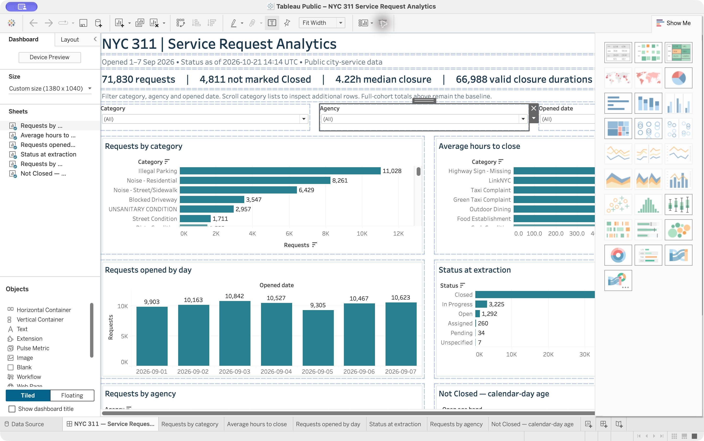
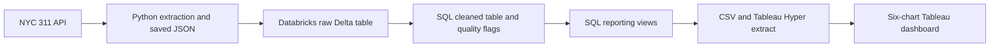

# NYC 311 Service Request Analytics

A learning and portfolio project that turns real NYC 311 API responses into validated Databricks tables and an interactive Tableau dashboard.

**71,830 requests · Python · Databricks · SQL · Delta Lake · Tableau Public**



The screenshot shows the original layout. The downloadable workbook now uses a compact 1000 × 760 layout with four summary cards and consistent chart spacing. Its data and filter definitions are unchanged. The user confirmed opening the updated workbook; a fresh screenshot is pending.

[Download the packaged Tableau workbook](tableau/cohort/NYC%20311%20Service%20Request%20Analytics.twbx) and open it in Tableau Public. Use GitHub's download button to download the binary file. The package contains its data; no live Databricks connection is needed to view it.

## The question

What do people report, which city agencies handle those requests, and how long do requests take to close? The dashboard supports exploring request volumes, status and closure durations. It illustrates information service teams could use to investigate workload and delays; no operational improvement or causal outcome was measured.

## Architecture



Python retrieves a creation-date cohort through keyset pagination with bounded retries. Raw records retain provenance and SHA-256 checksums. SQL parses and validates the fields and calculates valid durations. Databricks persists raw/cleaned Delta tables and reporting views. Tableau reads one row per request so filtered averages are calculated from the contributing requests.

## Delivered snapshot

Requests opened **1–7 September 2026**, retrieved **21 October 2026**, across 24 pages. This is a saved creation cohort, not today's live workload or a historical backlog reconstruction.

| Measure | Value |
| --- | ---: |
| Requests | 71,830 |
| Valid closure durations | 66,988 |
| Missing closure date | 4,105 |
| Closure/status mismatch | 712 |
| Negative duration | 25 |
| Not marked Closed at extraction | 4,811 |
| Mean valid closure hours | 87.05 |
| Median valid closure hours | 4.22 |

Invalid durations remain NULL, never zero. All requests remain in counts. Long durations pull the mean above the median. Closed status does not establish customer satisfaction or successful resolution.

## Dashboard

Six charts show category counts, average closure hours by category, daily openings, status, agency counts and calendar-day age of requests not marked Closed. Category, agency and opening-date filters narrow the charts. The header explicitly retains static full-cohort baseline totals. Native workbook rendering was checked; interactive filter acceptance was confirmed by the user.

## Validation

Stored raw payload hashes, all cleaned source fields and valid durations were reconciled to the API responses. Counts and median matched independent calculations. Replaying the same batch preserved full raw/cleaned contents and timestamps. Every typed Hyper value was read back and compared with the CSV. Package checks and three API failure-handling tests passed.

Selected executed SQL and recorded validation summaries are under `evidence/`. Full original API pages and workspace-specific SQL responses are retained locally, not committed. This public copy has configurable CLI access; a fresh cloud run of this portable copy has not been executed.

## Run locally

Python 3.9+ is required. Open the packaged workbook directly to explore the delivered snapshot. For local checks:

```sh
python3 -m unittest test_extract_cohort.py
python3 verify_tableau_package.py
```

For a new extraction:

```sh
python3 extract_cohort.py --start 2026-09-01 --end 2026-09-08
```

Read [RUN_GUIDE.md](RUN_GUIDE.md) for Databricks configuration, loading, extract rebuilding and failure recovery. Read [the request walkthrough](lesson-05-end-to-end.md) for an example from API JSON to chart.

## Scope and limitations

- Manual refresh; no scheduler, monitoring SLA, production deployment or ML model.
- Source timestamps have no timezone offset. Durations are source wall-clock hours, not UTC elapsed time across daylight-saving boundaries. Ageing assumes America/New_York.
- The API is mutable. Before/after counts agree, but pages are not an atomic snapshot.
- Insert-only batch replay is not CDC or an upsert model for later changes. Do not sum repeated snapshots as distinct requests.
- A complete second fresh extraction-to-dashboard refresh has not been tested. The delivered batch and its cloud replay were tested.
- Developed as a guided learning project with AI assistance; implementation evidence is separate from independent mastery.

Data source: [NYC Open Data 311 API](https://dev.socrata.com/foundry/data.cityofnewyork.us/erm2-nwe9). Data is publicly available city-service data; no addresses were selected. Source terms govern the data. No third-party data ownership is claimed.
